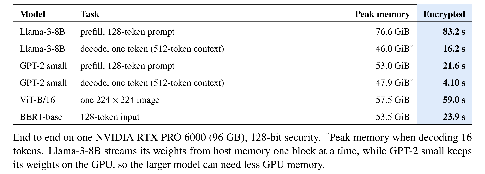
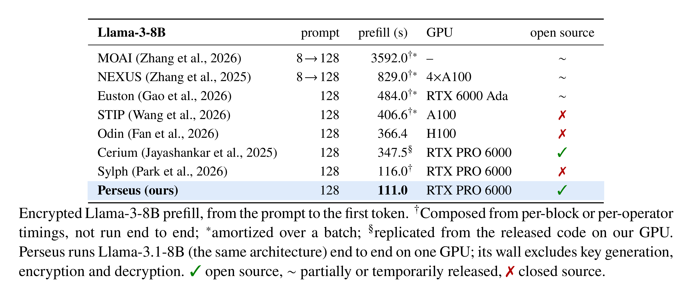
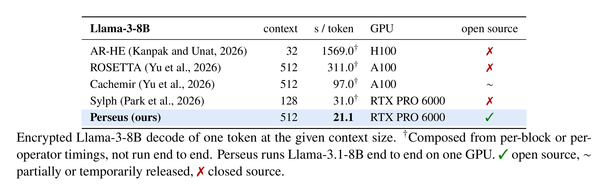
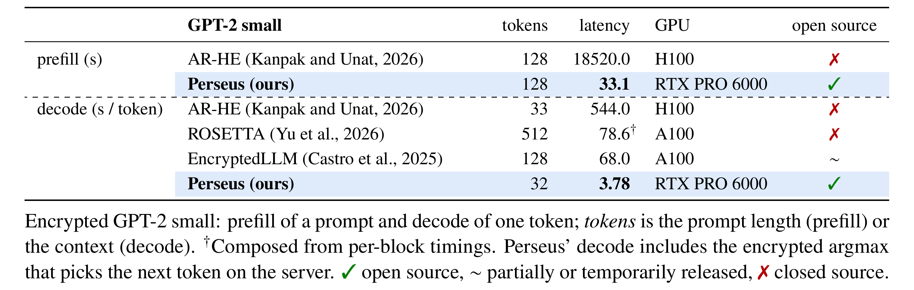
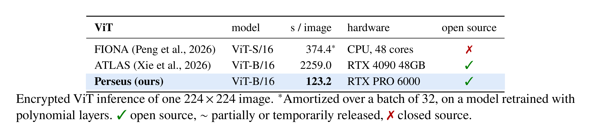
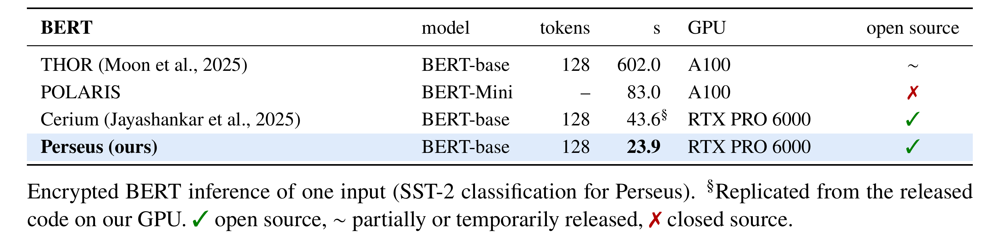

<p align="center">
  <a href="https://www.uniroma1.it/en"></a>
  &nbsp;&nbsp;&nbsp;&nbsp;&nbsp;&nbsp;&nbsp;&nbsp;&nbsp;&nbsp;
  <a href="https://www.gmu.edu"></a>
  &nbsp;&nbsp;&nbsp;&nbsp;&nbsp;&nbsp;&nbsp;&nbsp;&nbsp;&nbsp;
  <picture>
    <source media="(prefers-color-scheme: dark)" srcset="assets/paradigma-symbol-white.svg">
    <source media="(prefers-color-scheme: light)" srcset="assets/paradigma-symbol.svg">
    
  </picture>
</p>

<h1 align="center">Perseus</h1>

<p align="center"><b>An open Python framework for encrypted inference of large language models</b></p>

<p align="center">
  <a href="#results">Results</a> ·
  <a href="#reproduce">Reproduce</a> ·
  <a href="#0-install">Install</a> ·
  <a href="#python-api">Python API</a> ·
  <a href="#citation">Citation</a>
</p>

Perseus runs transformers under fully homomorphic encryption on a single GPU: the server computes
on data it never sees in the clear. Models, packings, nonlinear approximations and bootstrap
placement are plain Python, on top of
[FIDESlib32bits](https://github.com/gladia-research-group/FIDESlib32bits), our 32-bit GPU port
of [FIDESlib](https://github.com/CAPS-UMU/FIDESlib).

<p align="center">
  <a href="assets/paper-tables-overview-light.png">
    <picture>
      <source media="(prefers-color-scheme: dark)" srcset="assets/paper-tables-overview-dark.png">
      <source media="(prefers-color-scheme: light)" srcset="assets/paper-tables-overview-light.png">
      
    </picture>
  </a>
</p>

## What's inside

- **Python end to end.** GPT-2, Llama-3, BERT and ViT are Python programs on `perseus.impl`
  (`examples/*_from_primitives`), with readable packings, nonlinearities and layers.
- **In-kernel key regeneration.** Half of every key-switching key is regenerated on the GPU from a
  ChaCha12 seed instead of being stored.
- **Complex Cachemir packing.** Two real vectors per ciphertext, in the complex slots of CKKS.
- **Packing- and magnitude-aware bootstrap placement.** GPT-2 runs 416 bootstraps per token,
  against 584–894 for DaCapo, Orion and Fhelipe ([study](docs/PLACEMENT_STUDY.md)).

## Results

One NVIDIA RTX PRO 6000, 128-bit security. Prior results on their own hardware, or replicated on
ours where the code is released.

<p align="center">
  <a href="assets/paper-tables-llama-prefill-light.png">
    <picture>
      <source media="(prefers-color-scheme: dark)" srcset="assets/paper-tables-llama-prefill-dark.png">
      <source media="(prefers-color-scheme: light)" srcset="assets/paper-tables-llama-prefill-light.png">
      
    </picture>
  </a>
  <br>
  <a href="assets/paper-tables-llama-decode-light.png">
    <picture>
      <source media="(prefers-color-scheme: dark)" srcset="assets/paper-tables-llama-decode-dark.png">
      <source media="(prefers-color-scheme: light)" srcset="assets/paper-tables-llama-decode-light.png">
      
    </picture>
  </a>
  <br>
  <a href="assets/paper-tables-gpt2-light.png">
    <picture>
      <source media="(prefers-color-scheme: dark)" srcset="assets/paper-tables-gpt2-dark.png">
      <source media="(prefers-color-scheme: light)" srcset="assets/paper-tables-gpt2-light.png">
      
    </picture>
  </a>
  <br>
  <a href="assets/paper-tables-vit-light.png">
    <picture>
      <source media="(prefers-color-scheme: dark)" srcset="assets/paper-tables-vit-dark.png">
      <source media="(prefers-color-scheme: light)" srcset="assets/paper-tables-vit-light.png">
      
    </picture>
  </a>
  <br>
  <a href="assets/paper-tables-bert-light.png">
    <picture>
      <source media="(prefers-color-scheme: dark)" srcset="assets/paper-tables-bert-dark.png">
      <source media="(prefers-color-scheme: light)" srcset="assets/paper-tables-bert-light.png">
      
    </picture>
  </a>
</p>

Times exclude key generation, encryption and decryption. The protocol and every run are in
[`docs/RESULTS_2026-10-19.md`](docs/RESULTS_2026-10-19.md).

## Reproduce

After the [install](#0-install), each script prints one row's time and its accuracy against the
float64 model (`NODE`/`MEMS` bind it to the GPU's NUMA node):

```bash
GPU=0 NODE=1 MEMS=1,2 bash scripts/repro/llama_prefill128.sh   # Llama-3-8B, 128-token prefill
GPU=0 bash scripts/repro/gpt2_decode.sh                         # GPT-2, steady-token decode
GPU=0 bash scripts/repro/gpt2_prefill128.sh                     # GPT-2, 128-token prefill
GPU=0 bash scripts/repro/bert_base.sh                           # BERT-base, 128 tokens (SST-2)
GPU=0 bash scripts/repro/vit_base.sh                            # ViT-B/16, four EuroSAT images
```

Llama-3-8B needs access to `meta-llama/Llama-3.1-8B`; Llama, BERT and ViT were measured on a 96 GB
GPU.

## Layout

- `perseus/`
  - `impl/` the Python implementation: encrypted linear layers, attention, normalization and
    activations, plus the two execution modes, recording a forward pass and following a plan.
  - `plan/` the planner: it reads a recorded forward pass, simulates how levels are spent,
    places the bootstraps and picks each one's type. It also holds our ports of the DaCapo,
    Orion and Fhelipe planners.
  - `nn/`, `calibrate/`, `export.py` a PyTorch-like module API, the fitting of the polynomial
    approximations used for nonlinear functions, and the export of HuggingFace weights.
- `examples/{gpt2,llama,bert,vit}_from_primitives/` the four models on `perseus.impl`, with their
  runners; GPT-2 and Llama also with their planning scripts (`make_plan.sh`).
- `graphs/` the recorded forward passes the plans are computed from.
- `bootstrap_placements/` one directory per plan, each with the recipe that regenerates it and
  the runtime switches it was made for (`PLAN_CMD.txt`).
- `configs/model/approximation/` the fitted approximations of every model.
- `scripts/` build, run and planning scripts:
  - `scripts/repro/` one script per result.
  - `scripts/utils/{dacapo,orion}_upstream/` run the released DaCapo and Orion tools.
- `src/`, `include/` the CUDA runtime and its Python bindings: `perseus._core`, and
  `perseus._client`, the client side that runs without a GPU.
- `third_party/` the FIDESlib32bits submodule and our OpenFHE patches.
- `docs/` the Python API reference, the security model, the exact placement algorithm, the
  placement study and the results protocol.
- `tests/dev/` the GPU test suite (one program per check; needs a built tree).
- `notebooks/` walkthroughs for GPT-2, ViT and BERT.
- `assets/` the logos and the result tables (`paper-tables.tex`, `results-table.tex`, rendered by
  `render.sh`).

## Python API

There are two Python layers, and both run in one encrypted session. `perseus.impl` is the one
the results use: encrypted models written in Python, which can record a forward pass for the
planner and then run under the resulting plan. `examples/gpt2_from_primitives` is GPT-2
written with it. From the repository root, after the install below and
`source scripts/local_env.sh`, which points at the weights and the test inputs:

```python
import os
from examples.gpt2_from_primitives import env, weights
from examples.gpt2_from_primitives.model import Gpt2Model

PACKING = "cachemir_complex"                    # the data layout the shipped plans assume
sess = env.open_session(device=0, chain="n32", GPT2_PACKING=PACKING)   # parameters + keys
from perseus import _core                       # after the session has set its environment
from perseus.impl import config

model = Gpt2Model(sess.inf, weights.RawStore(os.environ["WEIGHTS_PATH"]),
                  config.load_configs("configs/model/approximation/gpt2_base_n32/configs.json"),
                  core=_core, packing=PACKING)
model.load_plans("bootstrap_placements/gpt2_decode_python_n32")      # without it: no plan
cfg = _core.RunConfig.from_env(); cfg.tokens = 4                    # the first 4 test tokens
out = model.run_decode(_core.read_teacher_forced_inputs(cfg), argmax=True)   # one record per token
print([(r["top1"], r["cutmax"]) for r in out])  # top token after decryption, top token picked encrypted
model.close(); sess.close()
```

Calling `model.set_capture(dir)` instead of `load_plans` records the forward pass the planner
reads (step 2 below). A new model subclasses `ImplModel` and lists its stages, the masks each
step needs and its weights; `perseus/impl/__init__.py` describes the modules, and
`docs/PYTHON_API.md` shows how to write a new operation.

`perseus.nn` is a PyTorch-like module API built on the runtime's C++ layers; the polynomial
approximations of its nonlinear functions are fitted on your data:

```python
import numpy as np
from perseus import session
from perseus.profile import SessionProfile
from perseus.nn import EncGELU, EncLinear, EncSequential, calibrate_sequential

d, e, real = 1024, 4096, 768                       # padded widths; 768 real features
rng = np.random.default_rng(0)
W1 = rng.standard_normal((d, e)) * 0.5 / np.sqrt(real); W1[real:, :] = 0; W1[:, 3072:] = 0
W2 = rng.standard_normal((e, d)) * 0.5 / np.sqrt(3072); W2[3072:, :] = 0; W2[:, real:] = 0

with session(profile=SessionProfile.custom_n32()) as s:     # parameters, keys, GPU context
    model = EncSequential(EncLinear("fc1", d, e, weight=W1), EncGELU("act"),
                          EncLinear("fc2", e, d, weight=W2)).bind(s)
    calibrate_sequential(model, rng.standard_normal((32, real)) * 0.3)   # fit GELU on your data
    x = rng.standard_normal(real) * 0.3
    y = s.decrypt(model(s.encrypt(x)), d=real)               # encrypted forward
```

`EncClient` and `EncServer` split the key holder from the server that computes
(`docs/SECURITY_MODEL.md`); `docs/PYTHON_API.md` is the full reference. The notebooks cover
preparing the files, generation, a custom encrypted model and the client-server split;
`NB=<name> bash scripts/run_notebooks.sh` runs one without opening Jupyter.

## Pipeline

The complete sequence for GPT-2 on the 32-bit parameters, from the weights to an encrypted run,
with the 64-bit differences. Llama-3 follows the same steps with
`examples/llama_from_primitives/make_plan.sh`. The BERT and ViT plans ship ready to run. Every
file a step produces is already in the repository, so any step can be skipped.

### 0. Install

You need:
- Linux and CUDA 12.6 or newer.
- A GPU with 48 GB or more of memory for GPT-2. The 32-bit run peaks at about 33 GiB, the 64-bit
  one at about 46 GiB. Llama-3-8B, BERT and ViT need more (they were measured on 96 GB).
- Python 3.11+, CMake 3.24+, gcc 12+ and `libarchive-dev`.
- NCCL: `libnccl2` and `libnccl-dev`, or `NCCL_HOME` pointing at a prefix with `lib/libnccl.so`
  and `include/nccl.h`.

```bash
git clone --recurse-submodules https://github.com/gladia-research-group/perseus
cd perseus
uv sync                                  # or: python -m venv .venv && .venv/bin/pip install -e ".[hf,dev]"
```

That installs the parts that need no GPU: the weight export, the approximation fitting and the
planner. Encrypted runs also need the CUDA extension:

```bash
NATIVE_SIZE=32 bash scripts/install_deps.sh      # patched OpenFHE + FIDESlib32bits -> deps_n32/
CHAIN=n32 bash scripts/local_build_core.sh       # perseus/_core.n32.so
.venv/bin/python -c "import perseus.nn"          # otherwise reports exactly what is missing
```

`NATIVE_SIZE=64` and `CHAIN=n64` build the 64-bit version next to it (`deps_n64/`,
`_core.n64.so`); the importable module is a symlink to whichever is active.
`scripts/local_env.sh` sets every default, and a variable you export yourself always wins:

| variable | what it points at | default |
|---|---|---|
| `CHAIN` | the parameter set: `n32` (32-bit) or `n64` (64-bit) | `n32` |
| `PERSEUS_DATA` | where the weights, the calibration text and the reference outputs live | `.cache/` |
| `WEIGHTS_PATH` | the exported weights (`weights.bin.zip`) | under `PERSEUS_DATA` |
| `CONFIGS_PATH` | the fitted approximations | unset: the scripts take `gpt2_base_n32` (`gpt2_base` for 64-bit) |
| `ALL_BLOCKS_IO_DIR` | the reference outputs that encrypted runs are checked against | under `PERSEUS_DATA` |

Without root, the prefix `NCCL_HOME` points at must hold **both** `lib/libnccl.so` (to link) and
`lib/libnccl.so.2` (to load), with `$NCCL_HOME/lib` on `LD_LIBRARY_PATH`. The
`nvidia-nccl-cu12` wheel ships only the second name, so symlink both from
`.venv/lib/python3.11/site-packages/nvidia/nccl/lib/`. `apt-get download libarchive-dev &&
dpkg-deb -x libarchive-dev_*.deb prefix` unpacks LibArchive's headers without installing
anything (pass `LibArchive_INCLUDE_DIR` and `LibArchive_LIBRARY`).

### 1. Export the weights, fit the approximations, compute the reference outputs

```bash
.venv/bin/perseus-export --model openai-community/gpt2 --out .cache/models/openai-community/gpt2
.venv/bin/python -c 'import numpy as np; from omegaconf import OmegaConf; from perseus.calibrate import data; \
    np.save(".cache/pools/openwebtext_gpt2.npy", np.asarray(data.load_token_pool("openai-community/gpt2", \
    OmegaConf.load("perseus/configs/dataset/openwebtext.yaml"))))'
.venv/bin/perseus-calibrate model=gpt2 dataset=openwebtext
.venv/bin/python scripts/utils/gen_gpt2_oracle.py --model openai-community/gpt2 \
    --pool .cache/pools/openwebtext_gpt2.npy --out .cache/oracle/gpt2/all_blocks_io
```

The export packs the weights for the runtime. The calibration fits a polynomial approximation
to every nonlinear function (LayerNorm, softmax, GELU and the encrypted argmax) on the value
ranges it sees on OpenWebText; the shipped `gpt2_base_n32/configs.json` is the one the results
use. The last command runs the plaintext model on a fixed piece of text and saves its inputs
and output logits: these reference outputs are what encrypted runs are compared against.

A model fine-tuned for encryption, such as the HEAT GPT-2, is exported on top of its base model
with `--checkpoint` (a `model.pt` file or a HuggingFace repository id):

```bash
.venv/bin/perseus-export --model openai-community/gpt2 \
    --checkpoint gladia/heat-gpt2-small-openwebtext --tag heat --out .cache/models/gladia/heat-gpt2
.venv/bin/python scripts/utils/gen_gpt2_oracle.py --model openai-community/gpt2 \
    --checkpoint gladia/heat-gpt2-small-openwebtext \
    --pool .cache/pools/openwebtext_gpt2.npy --out .cache/oracle/gpt2_heat/all_blocks_io
```

### 2. Record a forward pass

The planner reads a record of one encrypted forward pass: every encrypted value, how its data
is laid out and the largest magnitude it reaches. The first token runs without a plan and is
recorded block by block, the encrypted argmax included:

```bash
source scripts/local_env.sh
.venv/bin/python -m examples.gpt2_from_primitives.run_decode --tokens 1 --argmax \
    --capture graphs/gpt2_decode_python_n32
```

A recording belongs to one runtime build and one approximation config: change either and
record again.

### 3. Plan

The planner runs on the CPU, in seconds per plan (the comparison tools take minutes). Each plan
directory's `PLAN_CMD.txt` holds its recipe, and `make_plans.sh` replays them:

```bash
bash scripts/make_plans.sh gpt2_decode_python_n32     # the 32-bit plan
bash scripts/make_plans.sh                            # every plan in the repository
```

`python -m perseus.plan --help` lists the planner's options, among them the safety margin on
recorded magnitudes (`--mag-safety`), the accuracy target (`--err-target`), the largest scaling
setting (`--cf-max`), the sizes of the cheaper bootstrap (`--sparse-slots`), removing bootstraps
that turn out redundant (`--prune`) and the placement algorithm
(`--placer {min_cut,ilp,orion,dacapo,fhelipe}`, where `ilp` is the exact algorithm). The 32-bit
plans estimate each bootstrap's error from measurements (`perseus/plan/data/bts_accuracy_n32.json`),
the 64-bit plans from a formula.

The comparison plans of the [placement study](docs/PLACEMENT_STUDY.md) come from the released
tools. DaCapo needs its compiler, `hecate-opt`, built once (LLVM/MLIR 18); Orion's solver is
downloaded and patched on first use:

```bash
bash scripts/utils/dacapo_upstream/build_hecate.sh
bash scripts/make_plans.sh python/dacapo python/orion python/fhelipe
```

### 4. Run encrypted

```bash
source scripts/local_env.sh
DECODE=".venv/bin/python -m examples.gpt2_from_primitives.run_decode --tokens 16 --argmax"
$DECODE --plan bootstrap_placements/gpt2_decode_python_n32     # the shipped 32-bit plan
$DECODE --plan bootstrap_placements/python/dacapo              # a comparison plan (also python/orion, python/fhelipe)
$DECODE                                                        # no plan: bootstrap whenever a value runs out of levels
$DECODE --plan bootstrap_placements/gpt2_decode_python_n32_dense --set SPARSE_AUTO=0 --set SPARSE_BTS_SLOTS=0   # full-size bootstraps only
.venv/bin/python -m examples.gpt2_from_primitives.run_generate --prompt 4 --tokens 8 \
    --plan bootstrap_placements/gpt2_decode_python_n32          # generation: each chosen token is fed back encrypted
```

In generation, each new token re-enters the model as the output of a bootstrap instead of being
freshly encrypted, so a plan that supports generation also holds a second plan for block 0,
`block_0_feedback_placement.json`, used for those tokens (`bootstrap_placements/README.md`
lists which plans have one).

For the 64-bit row of the placement study, export `CHAIN=n64` before `source scripts/local_env.sh`,
point the import symlink at `_core.n64.so`, and pass `--chain n64 --plan bootstrap_placements/gpt2_decode_python_n64`.
`FIDESLIB_KSK_REGEN=0` or `FIDESLIB_KSK_PACK=0` reproduce its key-storage rows.

A run passes when it prints `[decode] PASS`: at every position the reference token stays among
the top few of the encrypted output (`GATE_REF_RANK_MAX`), and the divergence from the plaintext
output stays small (`GATE_KL_MAX`; a broken run shows a KL above 50). Matching the plaintext top
token is reported but not required. Time a run on an otherwise idle machine, with the process
pinned to the GPU's NUMA node (`numactl --cpunodebind=<node> --preferred=<node>`).

The runtime also has a native C++ driver for the same model (`scripts/run_task.sh`,
`RUNNER=cuda`). No recording or plan ships for it; it needs its own (`STAGE=capture`, then
`perseus-plan`).

## Citation

If you use Perseus, please cite the paper (GitHub's *Cite this repository* button reads
[`CITATION.cff`](CITATION.cff)):

```bibtex
@misc{zirilli2026perseus,
  title  = {Perseus: A Bootstrap Placer for Faster Encrypted Transformer Inference},
  author = {Zirilli, Alessandro and Marincione, Davide and Kornaropoulos, Evgenios M. and Ateniese, Giuseppe and Rodol{\`a}, Emanuele},
  year   = {2026},
  url    = {https://github.com/gladia-research-group/perseus}
}
```

## License

Perseus is released under the [Business Source License 1.1](LICENSE): free for any
non-commercial use (research, academic, evaluation); commercial use requires prior written
permission from the authors. On the Change Date (2030-08-18) the license converts to GPLv2.
`third_party/FIDESlib` keeps its own license.

<p align="center">
  <a href="https://gladia.di.uniroma1.it">
    <picture>
      <source media="(prefers-color-scheme: dark)" srcset="assets/gladia-logo-white.svg">
      <source media="(prefers-color-scheme: light)" srcset="assets/gladia-logo.svg">
      
    </picture>
  </a>
</p>

<p align="center"><sub><i>Perseus slew Medusa without ever looking at her, only at her reflection in a polished
shield. Perseus runs language models the same way, looking only at the ciphertext.</i></sub></p>
