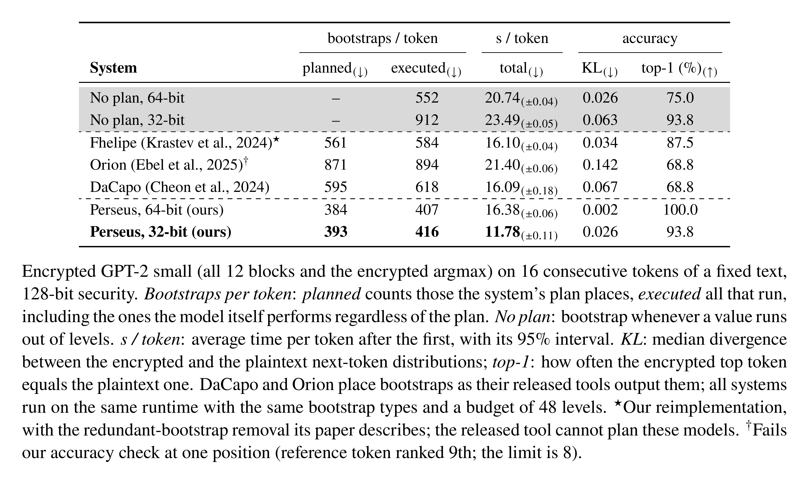

# Bootstrap placement study (GPT-2)

This is the comparison behind the placer paper (the citation in the README). Every system runs on the same runtime
with the same bootstrap types and a budget of 48 levels, so only the placement differs. The absolute times are those of
the runtime at the time of the study. Today's runtime decodes the same model at 3.78 s per token (README, Results). The
relative comparison between placers is what this table measures.

Encrypted GPT-2 small generating text on one NVIDIA RTX PRO 6000 Blackwell GPU, with a ring dimension of
216 and 128-bit security:

  <a href="../assets/results-table-light.png">
    <picture>
      <source media="(prefers-color-scheme: dark)" srcset="../assets/results-table-dark.png">
      <source media="(prefers-color-scheme: light)" srcset="../assets/results-table-light.png">
      
    </picture>
  </a>

Perseus runs on two CKKS parameter sets:
- The 32-bit one, the default, represents each level with a pair of 27-bit primes (27 levels).
- The 64-bit reference uses 28 levels of 53-bit primes.

Half of every key-switching key is pseudo-random. The runtime recomputes that half on the GPU from a seed instead of
storing it, and stores the other half bit-packed. The effect on the 32-bit row:

| key storage | s / token | GPU memory used |
|---|---|---|
| recomputed half + bit-packed half (default) | 11.86 | 32.55 GiB |
| recomputed half only (`FIDESLIB_KSK_PACK=0`) | 12.19 (+3%) | 34.49 GiB |
| bit-packed half only (`FIDESLIB_KSK_REGEN=0`) | 14.18 (+20%) | 41.61 GiB |

The README's Pipeline section reproduces every row: the plans are in `bootstrap_placements/`, the comparison plans come
from the released DaCapo and Orion tools, and `FIDESLIB_KSK_REGEN=0` / `FIDESLIB_KSK_PACK=0` give the key-storage rows.
The table's source is `assets/results-table.tex` (`bash assets/render.sh`).
