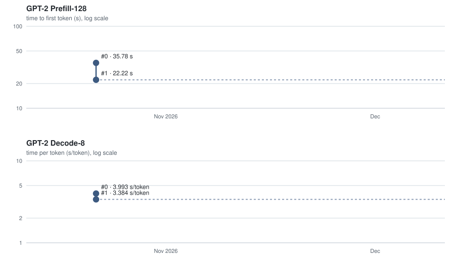

# Encrypted GPT-2 Speedrun

This folder of [Perseus](https://github.com/gladia-research-group/perseus) defines the Encrypted GPT-2 Speedrun, in which we optimize (collaboratively and
competitively) encrypted transformer inference under FHE for GPT-2 (124M) on a single RTX PRO 6000.
The client encrypts the request locally under CKKS at 128-bit security; the server receives the encrypted prompt and computes on ciphertexts only. It first populates the caches and then decodes the answer, as in an inference-as-a-service scenario.

Under this framing, the task naturally includes two tracks:

- **Prefill-128.** The user's encrypted prompt (128 tokens) populates the KV caches.
- **Decode-8.** From a fixed, given cache state, the model decodes 8 tokens, at positions 8 to 15, under teacher forcing on unknown test sequences.

The result of each is an end-to-end time, and a KL divergence between the plaintext GPT-2 logits and the encrypted ones, which must stay below 10⁻² in prefill, where it is taken on the last position's logits, and below 10⁻³ in decode, where it is the average over the timed positions.

Every entry is a pull request to Perseus: a change to its code, and a record folder here. You can also
change the cryptographic backend. The default is [perseus-core](https://github.com/gladia-research-group/perseus/tree/main/crates),
Perseus's Rust + CUDA runtime. Modify it, or include another backend as a submodule and wire it in.

To learn how to submit an entry, see [Submitting](#submitting).

## Running the current record

The current record is record 1, at the commit its client pins (`PERSEUS` in
[`harness/perseus_core_client.py`](harness/perseus_core_client.py)). Clone Perseus (your fork, for an entry) and
build that commit next to it; the commands here run from the clone's root:

```bash
git clone https://github.com/gladia-research-group/perseus && cd perseus
git worktree add ../perseus-client 89bc830017fe12ab967ddb10c24feae65d8af6df   # record 1, the client's commit
cd ../perseus-client
uv venv --python 3.12 .venv && uv pip install --python .venv/bin/python -e ".[hf,examples,dev]"
.venv/bin/maturin develop --release           # the Rust + CUDA runtime (rustup, CUDA 13.2)
.venv/bin/perseus-export --model openai-community/gpt2 --out .cache/models/openai-community/gpt2
cd ../perseus
```

Then time it as entries are timed, with the harness in this folder: the client (keys, encryption,
the checks) and the server (the entry) run in separate sandboxes, on the dev prompts
([`prompts/dev.json`](prompts/dev.json), from C4).

```bash
bash speedrun/runner/entry.sh perseus-core ../perseus-client decode 0    # Decode-8 on GPU 0
bash speedrun/runner/entry.sh perseus-core ../perseus-client prefill 0   # Prefill-128
python3 speedrun/harness/score.py --track decode --entry speedrun/runs/*/run.json
```

An entry runs the same way, from its own checkout built the same way, with that build as the client:
`CLIENT=../perseus-client bash speedrun/runner/entry.sh perseus-core . decode 0`. The client holds the secret key
and the prompts, so it only runs the Perseus commit its client file pins, built by you; `runner/run.py`
refuses any other checkout. The server reads GPT-2's weights from the client checkout's export, read-only at
`$WEIGHTS_PATH`. Its checkout may link outside itself (top-level symlinks, its venv's interpreter) only where the
client's checkout links, or into the directories of `ALLOW=DIR[:DIR...]`.

You need Linux, `bwrap`, a systemd user session and a GPU with 48 GB or more, and `HF_HOME` must hold
the `openai-community/gpt2` weights, which the float64 reference reads. On a machine with several NUMA
nodes, `NUMA=NODE[:MEMS]` pins the server to the GPU's node (with `numactl`). Perseus's own scripts
(`scripts/repro/gpt2_decode.sh`, `scripts/repro/gpt2_prefill128.sh`) time the same models in one process.

## Records

<p align="center">
  <picture>
    <source media="(prefers-color-scheme: dark)" srcset="records/progress-dark.svg">
    
  </picture>
</p>

The chart fills in as records are accepted.

### Track 1: Prefill-128

| # | Time to first token (s) | Peak GPU memory | Description | Date | Log | Contributors |
|---|---|---|---|---|---|---|
| 0 | 35.78 | 90.9 GiB | Baseline: Perseus on [FIDESlib32bits](https://github.com/gladia-research-group/FIDESlib32bits) | 2026-10-22 | [log](records/2026-10-22_Perseus) | [@alexzilligmm](https://github.com/alexzilligmm), [@Davide-F5-Marincione](https://github.com/Davide-F5-Marincione) |
| 1 | 22.22 | 57.4 GiB | Perseus on [perseus-core](https://github.com/gladia-research-group/perseus/tree/main/crates), its Rust + CUDA runtime, with its own client | 2026-10-22 | [log](records/2026-10-22_PerseusCore) | [@alexzilligmm](https://github.com/alexzilligmm), [@Davide-F5-Marincione](https://github.com/Davide-F5-Marincione) |

### Track 2: Decode-8

| # | s/token | Peak GPU memory | Description | Date | Log | Contributors |
|---|---|---|---|---|---|---|
| 0 | 3.993 | 74.5 GiB | Baseline: Perseus on [FIDESlib32bits](https://github.com/gladia-research-group/FIDESlib32bits) | 2026-10-22 | [log](records/2026-10-22_Perseus) | [@alexzilligmm](https://github.com/alexzilligmm), [@Davide-F5-Marincione](https://github.com/Davide-F5-Marincione) |
| 1 | 3.384 | 47.8 GiB | Perseus on [perseus-core](https://github.com/gladia-research-group/perseus/tree/main/crates), its Rust + CUDA runtime, with its own client | 2026-10-22 | [log](records/2026-10-22_PerseusCore) | [@alexzilligmm](https://github.com/alexzilligmm), [@Davide-F5-Marincione](https://github.com/Davide-F5-Marincione) |

## Rules

The only rules are that new records must:

1. Change only the framework and its backend. The weights, the test prompts and the harness (the checks and the clock) are fixed. Key generation, encryption and decryption belong to the backend's client: an entry that changes the key or ciphertext formats adds its own, which the maintainers review and pin.
2. Keep 128-bit security, with the server computing on ciphertexts only. Every secret and switching key must reach 128 bits on the Lattice Estimator, at the modulus where it is used, and the server gets only the public and evaluation keys.
3. Attain a KL divergence from float64 GPT-2 below 10⁻² for Prefill-128 and 10⁻³ for Decode-8, at p < 0.01 over the official runs.
4. Keep all input-dependent work inside the clock. Loading keys, encoding weights and loading plans are untimed setup and must not depend on the prompt.
5. Run faster than the current record on the reference GPU, by at least 1 % (or three standard errors, if larger) at p < 0.01 over paired runs ([`harness/score.py`](harness/score.py)).

The maintainers review every PR and may decline a record that moves work into the unscored decode positions, or that makes the framework much harder to read for a small gain. Other than that, anything and everything is fair game (e.g. the backend, kernels, CKKS parameters, packing, the approximations, bootstrap placement...).

## Tasks

Both tracks use [`openai-community/gpt2`](https://huggingface.co/openai-community/gpt2) (124M
parameters). The weights are fixed. The approximations are part of the challenge: an entry can refit
or replace the polynomials for LayerNorm, softmax, GELU and the argmax, as long as the outputs stay
within the KL bound above.

The current record opens the session (CKKS parameters on the 32-bit chain, keys) with
[`env.py`](https://github.com/gladia-research-group/perseus/blob/main/python/perseus/examples/gpt2/env.py).
Its approximations are fitted per layer in
[`gpt2_base_n32`](https://github.com/gladia-research-group/perseus/tree/main/python/perseus/configs/model/approximation/gpt2_base_n32) (Decode-8) and
[`gpt2_base_n32_thor`](https://github.com/gladia-research-group/perseus/tree/main/python/perseus/configs/model/approximation/gpt2_base_n32_thor) (Prefill-128):
GELU, LayerNorm and softmax in every block, and CutMax for the argmax.

### Track 1: Prefill-128

The current record's server runs the planned prefill
([`PlannedPrefill`](https://github.com/gladia-research-group/perseus/blob/main/python/perseus/impl/prefill.py)) with the plan
[`bootstrap_placements/gpt2_prefill128_m16s0_tail`](https://github.com/gladia-research-group/perseus/tree/main/bootstrap_placements/gpt2_prefill128_m16s0_tail).
[`scripts/repro/gpt2_prefill128.sh`](https://github.com/gladia-research-group/perseus/blob/main/scripts/repro/gpt2_prefill128.sh) times the same prefill in one process,
through [`run_prefill.py`](https://github.com/gladia-research-group/perseus/blob/main/python/perseus/examples/gpt2/run_prefill.py).

- [`prefill.py`](https://github.com/gladia-research-group/perseus/blob/main/python/perseus/examples/gpt2/prefill.py) runs the 128 positions through the 12 blocks, packed as complex chunk
  pairs, and keeps every block's K and V on the GPU.
- The timed pass follows one untimed warm-up on another prompt.
- The speedrun adds the encrypted tail: the last position moves into the decode layout, then the final
  LayerNorm, the LM head and CutMax run as in the decode, as two more stages (`Gpt2Prefill.tail_stages`).
  Perseus's own script runs them with `--tail`, and otherwise computes them in the clear on decrypted rows
  (`plain_logits`).

### Track 2: Decode-8

The current record's server drives Perseus's served decode,
[`perseus.serve.gpt2_decode`](https://github.com/gladia-research-group/perseus/blob/main/python/perseus/serve/gpt2_decode.py), with the plan
[`bootstrap_placements/gpt2_decode_python_n32_m16i`](https://github.com/gladia-research-group/perseus/tree/main/bootstrap_placements/gpt2_decode_python_n32_m16i).
[`scripts/repro/gpt2_decode.sh`](https://github.com/gladia-research-group/perseus/blob/main/scripts/repro/gpt2_decode.sh) times the same decode in one process, through
[`run_decode.py`](https://github.com/gladia-research-group/perseus/blob/main/python/perseus/examples/gpt2/run_decode.py), with per-token times.

- [`model.py`](https://github.com/gladia-research-group/perseus/blob/main/python/perseus/examples/gpt2/model.py) holds the per-block K/V caches and the decode step: the 12 blocks of
  [`block.py`](https://github.com/gladia-research-group/perseus/blob/main/python/perseus/examples/gpt2/block.py) on the new position, then the final LayerNorm, the LM head and the CutMax
  encrypted argmax in [`head.py`](https://github.com/gladia-research-group/perseus/blob/main/python/perseus/examples/gpt2/head.py).
- The inputs are teacher-forced. Positions 0 to 7 fill the cache, and their time is reported but not
  scored. The score is the time of positions 8 to 15, divided by 8.
- Today the script decodes 16 tokens and reports the median of the steady tokens (position ≥ 1).

### Client and server

The harness runs the client and the server as separate processes, each in its own sandbox, and they
talk only through files: the client writes `in/`, the server writes `out/`
([`harness/protocol.py`](harness/protocol.py)). The server is the entry's `speedrun/serve.sh`, started
with `--track {prefill,decode} --inbox IN --outbox OUT`. It must:

1. write `out/keyspec`, its key request: the keys its plan needs, in its backend's terms. The client generates
   only the keys its backend declares: record 1's refuses, for example, a SPRU block key of other than 64 blocks
   or a sparse secret above the bottom level;
2. wait for `in/keys.done`, then load the client's key bundle from `in/keys/` (it holds no secret key);
3. set up, untimed (the weights from `$WEIGHTS_PATH`, plans, a warm-up on a public prompt), then write
   `out/ready` with what the client needs to encrypt, such as the input level;
4. answer every request k: Prefill-128 reads the encrypted prompt `in/k/0` and writes `out/k/0`, the last
   position's logits and argmax; Decode-8 reads the tokens `in/k/0` to `in/k/15` one at a time, from an
   empty cache, and writes `out/k/j` before token j + 1 is released;
5. exit at `in/quit`.

Every file is an 8-byte length and the payload, written under a temporary name and renamed. The current
record's server is [`speedrun/server.py`](https://github.com/gladia-research-group/perseus/blob/main/speedrun/server.py).

## Submitting

1. **Develop on any GPU** with 48 GB or more. Run the current record on the same GPU to compare (see
   [Running the current record](#running-the-current-record)).
2. **Push** every submodule repository your change pins.
3. **Open a PR to Perseus** with your change and a new folder `speedrun/records/<YYYY-MM-DD>_<Name>/`,
   copied from [`records/_template`](records/_template):
   - `README.md`: a short write-up, an ablation table and a Disclosures section;
   - `submission.json`: the authors, a one-line summary, the CKKS parameters (`ckks`: log N, log QP,
     the secret, every sparse key) and your numbers next to the record's on the same GPU;
   - your run logs;
   - if your backend has its own key or ciphertext formats, its client, `speedrun/harness/<name>_client.py`,
     whose class `Backend` does the keygen for your server's key request, the encryption and the
     decryption (see [`harness/perseus_core_client.py`](harness/perseus_core_client.py)), and which pins
     a commit of your PR that has its final client code (`PERSEUS = "<sha>"`). It runs as
     `bash speedrun/runner/entry.sh <name> ...`.

   Leave the rest of this folder (`harness/`, `runner/`, `prompts/`, the other records, this README),
   `.github/` and the licence as they are.
4. **A check runs on the PR**: that it leaves those alone, the record folder, the fields, the main key at
   128-bit security on the HE standard, and the client's code: a PR that changes `crates/pc-client/` or
   `python/perseus/client/` must bring its own client. When the check passes, a maintainer is asked to
   review.
5. **The maintainers time it** within 72 hours of the check passing, at the commit the check names
   (a new push starts the review again), with the harness of Perseus `main`, against the current record on
   the reference GPU and the hidden test prompts, run the Lattice Estimator on the sparse keys, check
   the [rules](#rules) and post the results on the PR. An accepted record is merged into `main` with a
   merge commit, so the commit they timed stays in its history, and becomes the one to beat.

## Background

**The NanoGPT speedrun.** This challenge is inspired by the NanoGPT speedrun
([Jordan et al., 2024](https://github.com/KellerJordan/modded-nanogpt)), in which contributors
search, collaboratively and competitively, for the fastest way to train a language model to 3.28
cross-entropy loss on the FineWeb validation set with 8 NVIDIA H100 GPUs. Its record went from the
45 minutes of the llm.c GPT-2 replication to under 40 seconds. We borrow its format: fixed hardware,
a fixed quality bar, a public record history, and rules that leave everything else open. Here the
workload is encrypted inference instead of training, and the bar is 128-bit security and the KL.

**Threat model.** A client $`C`$ wants to prompt the model, and a server $`S`$ runs it. $`C`$ generates the
keys, keeps the secret key $`sk`$ and gives $`S`$ the public and evaluation keys. $`C`$ tokenizes and
encrypts the prompt locally, so $`S`$ never sees the tokens, the activations, the KV cache or the
logits, which it returns encrypted. $`S`$ is honest but curious, i.e. it follows the protocol but may try to
learn about the prompt from what it computes. Its computation must be oblivious, meaning that neither
its control flow nor its memory accesses depend on the prompt. Hardware side channels and metadata
such as the sequence length are out of scope.

**Homomorphic arithmetic.** CKKS
([Cheon et al., ASIACRYPT 2017](https://doi.org/10.1007/978-3-319-70694-8_15)) is an FHE scheme for
approximate arithmetic on real and complex vectors. If $`c_1 \leftarrow \mathrm{Enc}_{pk}(\mathbf{p}_1)`$
and $`c_2 \leftarrow \mathrm{Enc}_{pk}(\mathbf{p}_2)`$, then

```math
\mathrm{Dec}_{sk}(c_1 \oplus c_2) \approx \mathbf{p}_1 + \mathbf{p}_2, \qquad
\mathrm{Dec}_{sk}(c_1 \otimes c_2) \approx \mathbf{p}_1 \odot \mathbf{p}_2, \qquad
\mathrm{Dec}_{sk}(\mathrm{Rot}_k(c_1)) \approx \pi^k(\mathbf{p}_1),
```

where $`\oplus`$ and $`\otimes`$ are encrypted addition and element-wise multiplication, and
$`\mathrm{Rot}_k`$ rotates the vector cyclically by $`k`$ positions. The server has these three
operations and nothing else.

**Encoding.** Let $`N`$ be a power of two ($`N = 2^{16}`$ here) and $`R = \mathbb{Z}[X]/(X^N + 1)`$. A vector
$`\mathbf{z} \in \mathbb{C}^{N/2}`$ is encoded at a scale $`\Delta`$ as the integer polynomial
$`m = \lfloor p \rceil \in R`$, where $`p`$ takes the value $`\Delta z_j`$ at the root $`\omega_j`$ of
$`X^N + 1`$ and $`\Delta \bar{z}_j`$ at its conjugate. Decoding reads $`z_j \approx m(\omega_j)/\Delta`$.
The $`N/2`$ entries of $`\mathbf{z}`$ are the *slots*. Evaluation at $`\omega_j`$ is a ring homomorphism,
so sums and products of polynomials act on the slots element-wise, and encoding and decoding are an
inverse and a forward discrete Fourier transform.

**Levels.** A ciphertext of $`m`$ is a pair $`(b, a)`$ of polynomials modulo $`Q`$ with
$`b + a s \equiv m + e \pmod{Q}`$, for the secret key $`s`$ and a small noise $`e`$. The product of two
ciphertexts holds its message at scale $`\Delta^2`$, and *rescaling* divides it by $`\Delta`$, which
removes a factor $`\Delta`$ from the modulus. With $`Q_\ell = q_0 \Delta^\ell`$, a fresh ciphertext has
level $`L`$ and each multiplication spends one level, so a circuit deeper than $`L`$ needs a refresh.

**Bootstrapping.** Bootstrapping
([Gentry, 2009](https://crypto.stanford.edu/craig/craig-thesis.pdf); for CKKS,
[Cheon et al., EUROCRYPT 2018](https://doi.org/10.1007/978-3-319-78381-9_14)) refreshes a ciphertext
whose levels are spent. At level 0, $`b + a s = m + q_0 t`$ for an integer polynomial $`t`$ that depends
on $`s`$. Bootstrapping raises the modulus, moves the coefficients into the slots with a homomorphic
DFT (CoeffToSlot), removes the multiple of $`q_0`$ with a polynomial approximation of a sine (EvalMod)

```math
m_i \approx \frac{q_0}{2\pi} \sin\left(\frac{2\pi\,(m_i + q_0 t_i)}{q_0}\right), \qquad |m_i| \ll q_0,
```

and moves the result back (SlotToCoeff). A bootstrap costs two to three orders of magnitude more than
any other operation, so the depth of the circuit and where its bootstraps go decide most of the
latency.

**Why approximations.** Only additions, multiplications and rotations run under encryption, so every
nonlinear operation is approximated. In GPT-2 these are the $`1/\sqrt{x}`$ of LayerNorm, the
exponential and the division of softmax, GELU and the argmax. Common choices are Goldschmidt
iterations for division, Newton–Raphson iterations for $`1/\sqrt{x}`$, and Chebyshev or Remez
polynomials. An iterative method refines a seed $`F_0(x)`$ into estimates
$`F_1(x), \ldots, F_n(x) \to f(x)`$, and for quadratically convergent methods

```math
\varepsilon_n := \sup_{x \in \mathcal{D}} |F_n(x) - f(x)| \le M\, r^{2^n}, \qquad M > 0,\ r \in (0, 1),
```

where $`\mathcal{D}`$ is the set of inputs whose seed lies in the convergence interval. The error falls
doubly exponentially in $`n`$, but each iteration costs a fixed number of multiplications, so the
depth grows linearly. Every approximation trades accuracy for levels, and so for bootstraps. This
trade is open in the speedrun: an entry can refit any approximation while the KL stays below
$`10^{-2}`$ in prefill and $`10^{-3}`$ in decode.

**Reference hardware.** Scored attempts will be run on a server with:

- **GPU:** one NVIDIA RTX PRO 6000 Blackwell Server Edition (96 GB).
- **CPU:** 2 x Xeon 6960P.
- **RAM:** 256 GB.

The server runs pinned to the GPU's NUMA node, with its CPU time capped at that node's CPUs and its memory at
160 GB; the client's memory is capped at 64 GB.

## License

In this folder, `harness/`, `runner/`, `prompts/` and `records/` are under [Apache-2.0](LICENSE). The rest of
Perseus, the server files in this folder (`server.py`, `serve.sh`, `record1.py`, `make_tail_plan.sh`) included, is
under [BUSL-1.1](../LICENSE): free for non-commercial use.
